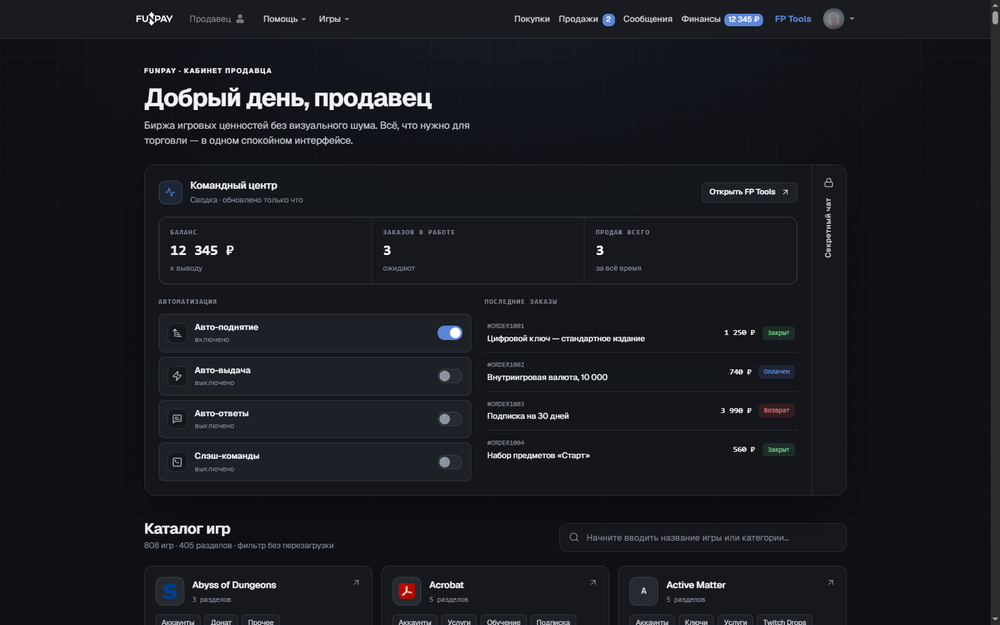

# FunPay Tools

**Browser extension for FunPay sellers** — sales analytics, auto-bump, auto-replies, auto-delivery and bulk lot editing in one clean graphite UI.

**English** · [Русский](README.ru.md)

## Quick start

1. [Download the ZIP](https://github.com/Kevanko/FunPay-Tools/archive/refs/heads/main.zip) and unpack it.
2. Open `chrome://extensions` and turn on **Developer mode**.
3. Click **Load unpacked** and select the folder with `manifest.json`.
4. Open [funpay.com](https://funpay.com/) — the **FP Tools** button appears in the site header.

Works in Chrome, Edge, Opera, Yandex Browser and other Chromium browsers.

## Features

Version 3.14 adds account-scoped IndexedDB history, purchases and balance history, CSV/JSON exports, lot notes, a new-chat entry point and public order-to-lot drafts. Currency totals stay separate. Eight themes and system fonts share one palette between the popup and site panel.

[FunPay Pocket for Android](android/README.md) runs chats and lot raising locally without a VPS. Continuous background work follows Android limits; see the app guide. [Private cloud migration](cloud/SECURITY.md) requires a separate Worker/database rollout.

- **Analytics** — revenue by currency, average order, statuses, top buyers and products, charts by day, any period.
- **Automation** — auto-bump with per-second timer, auto-replies and review replies by templates, auto-delivery with stock tracking, Telegram/Discord notifications.
- **Lots** — bulk price edit, pin, duplicate, disable, delete; export/import, clone to other categories, inline price edit.
- **Chat** — multi-image messages, search in dialog, templates and slash commands, buyer history, AI assistant.
- **UI** — four themes (graphite, obsidian, blue-gray, light), custom accent, no flash on page load.

## Support the fork author

USDT / TON. Transfers from sanctioned exchanges (HTX, EXMO, etc.) may not arrive.

| Network | Address |
| :--- | :--- |
| **TON** | `UQB-SA6hyUZ0nse40I8LvHqJFShZ443MO1lRqGNbxZp1Kl30` |
| **USDT · TRON (TRC20)** | `TUZjiFiDi1XScM4DDhqBRg9fbjRuWgc9tH` |
| **USDT · Ethereum (ERC20)** | `0x8EBe92e82E92BFC24BAF5471015bfc5077684eFb` |
| **USDT · Solana (SPL)** | `xnB1k5ZAp8XzqrjWSpd6AagxwHizUpspFqF12LWxbTf` |

## License

MIT — see [LICENSE](LICENSE). Fork of [FunPay Tools](https://github.com/XaviersDev/FunPay-Tools) by XaviersDev, with a reworked design and logic.
