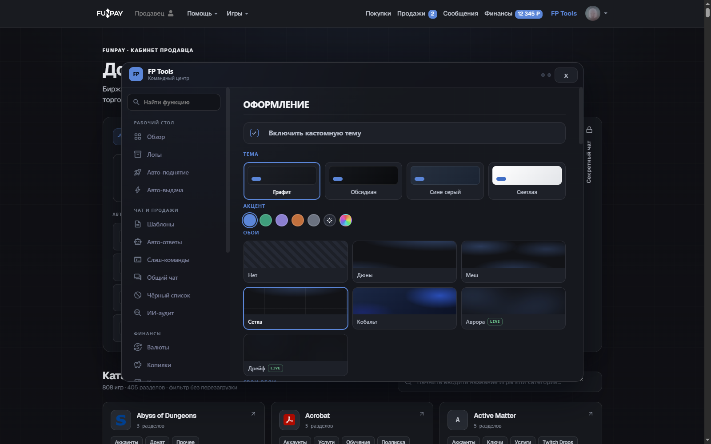
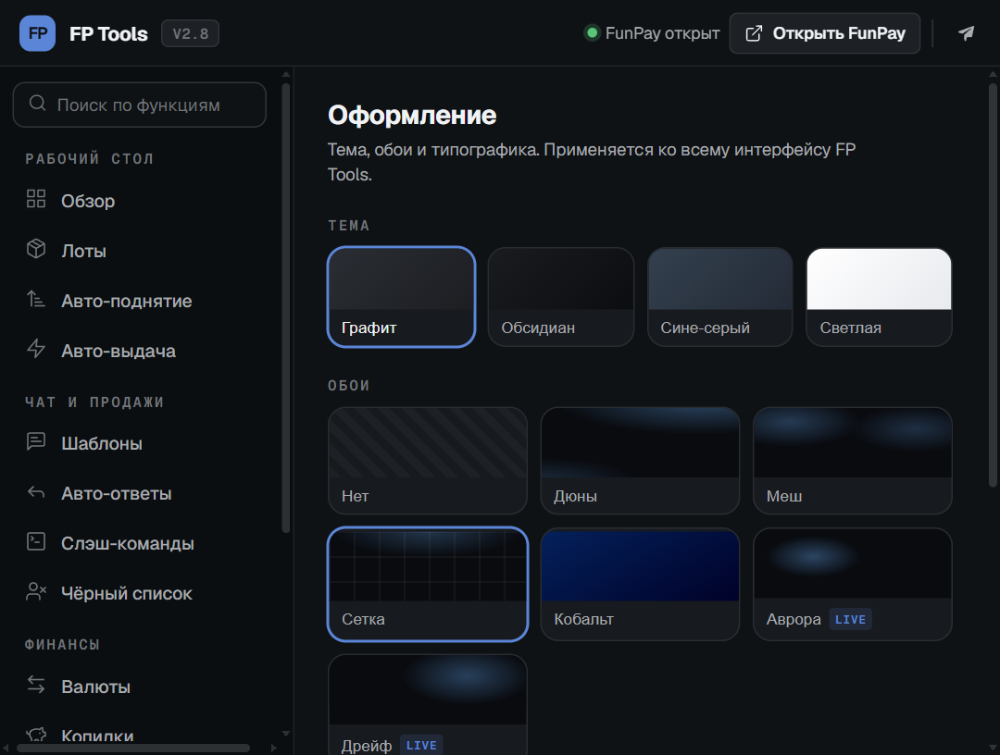

# FunPay Tools

**Браузерное расширение для продавцов FunPay** — аналитика, авто-поднятие, автоответы, авто-выдача и массовая работа с лотами. Темы: глина, бумага, лес, чернила и четыре прежних пресета.

[English](README.md) · **Русский**

## Быстрый старт

1. [Скачай ZIP](https://github.com/Kevanko/FunPay-Tools/archive/refs/heads/main.zip) и распакуй.
2. Открой `chrome://extensions` и включи **Режим разработчика**.
3. Нажми **Загрузить распакованное расширение** и выбери папку с `manifest.json`.
4. Открой [funpay.com](https://funpay.com/) — в шапке сайта появится кнопка **FP Tools**.

Работает в Chrome, Edge, Opera, Яндекс Браузере и других браузерах на Chromium.

Для автообновлений из GitHub в Chrome на Windows установите [локальный компонент обновления](desktop/README.md). Он обновляет отдельную копию расширения с проверкой SHA-256. При переходе с другой папки один раз экспортируйте и импортируйте настройки.

## Бесплатный ИИ

В меню расширения откройте **ИИ → Подключить Groq**. Создайте ключ в [Groq](https://console.groq.com/keys), вставьте его в форму, сохраните и нажмите **Проверить ИИ**. Для бесплатной квоты используйте план Free; действующие ограничения показаны в аккаунте Groq.

Доступны GPT OSS 120B и 20B. Запросы идут прямо в Groq, ключ хранится отдельно в этом браузере и не включается в экспорт, QR или облачную синхронизацию. Перед отправкой покупателю проверьте исправленный текст. Сервер исходного автора можно выбрать вручную; автоматического переключения на него нет.

## Возможности

В 3.14: история по аккаунтам в IndexedDB, покупки и история баланса, детализация и CSV/JSON, заметки лотов, новый чат и черновик лота из заказа. Средний чек и выручка считаются раздельно по валютам. Popup содержит быстрые настройки и переходы к полным редакторам сайта.

Локальная Android-версия [FunPay Pocket](android/README.md) обслуживает чаты и поднятие лотов без VPS. На телефоне доступны восемь тем, Manrope и пять системных шрифтов, процедурные обои и перенос `.fpconfig` или QR; ограничения фоновой работы описаны в инструкции приложения.

Приватная синхронизация требует [обновления Worker и схемы базы](cloud/SECURITY.md). Секрет доступа переносится отдельным `.fptsync`. Неизвестный результат автоматической отправки виден в диагностике и не повторяется без проверки.

- **Аналитика** — выручка по валютам, средний чек, статусы, топ покупателей и товаров, графики по дням, любой период.
- **Автоматизация** — авто-поднятие с точным таймером, автоответы и ответы на отзывы по шаблонам, авто-выдача с учётом остатка, уведомления в Telegram/Discord.
- **Лоты** — массовое изменение цен, закрепление, дублирование, отключение, удаление; экспорт/импорт, клонирование в другие категории, редактирование цены на странице.
- **Чат** — несколько картинок в одном сообщении, поиск по диалогу, шаблоны и слэш-команды, история покупок собеседника, ИИ-помощник.
- **Интерфейс** — восемь тем, системные шрифты, свой акцентный цвет, клавиатурное управление.

| Командный центр | Настройки оформления | Попап |
| :---: | :---: | :---: |
|  |  |  |

## Поддержка автора форка

USDT / TON. Переводы с бирж под санкциями (HTX, EXMO и т.п.) могут не дойти.

| Сеть | Адрес |
| :--- | :--- |
| **TON** | `UQB-SA6hyUZ0nse40I8LvHqJFShZ443MO1lRqGNbxZp1Kl30` |
| **USDT · TRON (TRC20)** | `TUZjiFiDi1XScM4DDhqBRg9fbjRuWgc9tH` |
| **USDT · Ethereum (ERC20)** | `0x8EBe92e82E92BFC24BAF5471015bfc5077684eFb` |
| **USDT · Solana (SPL)** | `xnB1k5ZAp8XzqrjWSpd6AagxwHizUpspFqF12LWxbTf` |

## Лицензия

MIT — см. [LICENSE](LICENSE). Форк [FunPay Tools](https://github.com/XaviersDev/FunPay-Tools) от XaviersDev с переработанным дизайном и логикой.
